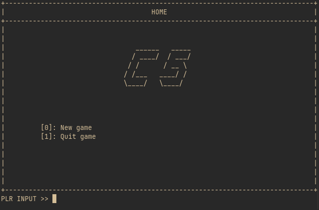
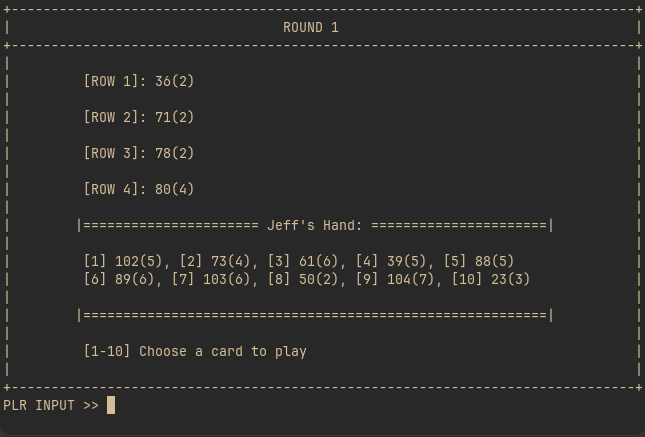

# C5 Card Game

A fun card game where players have to play strategically to avoid collecting "Catfaces", if a player collects up to 66 catfaces, the game ends and the player with the least number of catfaces wins! 
This version is made in C++ and is TUI-based.



## Table of Contents
- Demonstration
- Installation
- Description

## Demonstration
Here is a demo video of the game! (It's in the Issues tab)
https://github.com/ed1-ble/C5-game/issues/1#issue-5201799441

Image of in-game round (subject to change)


## Installation

### Prerequisites

- C++20 compiler (g++ 10+)
- Make (To use the makefile)
- POSIX/Unix environment (Linux, macOS, WSL2 Windows)

1. Clone the repo
```bash
git clone https://github.com/ed1-ble/C5-game
cd C5-game
```

2. Build with Make
```bash
make
```

3. Run the executable
```bash
./game
```

### Windows Users

For Windows, use [WSL2](https://learn.microsoft.com/en-us/windows/wsl/):
```bash
wsl --install
# Then follow Linux instructions inside WSL
```
## Description

- The game has a window width and height of 22 x 80 (see /src/main.cpp line 10 & 11).
- Headers:
    - card.hpp: contains several functions for manipulating cards (e.g. drawCard, deleteCard etc.)
    - game.hpp: contains functions & class related to board manipulation and game state (e.g. Board class, PlaceCard, CollectRow etc.)
    - tui.hpp: contains functions mainly for manipulating screen display, like the alignment and lines and borders, or flushing the screen.